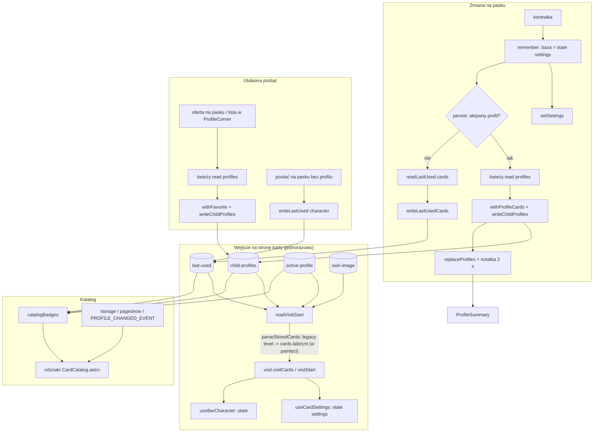

# Research: przepływ zapisu i odczytu ustawień kart oraz ulubionej postaci profilu dziecka

**Date**: 2026-11-03
**Git Commit**: 88602e1 (gałąź `chore/dependency-cruiser`; w drzewie tylko nieśledzone `arena-cover.png` i `context/map/`)
**Repository**: printo-kids

## Research Question

Przeanalizuj przepływ zapisu i odczytu ustawień kart oraz ulubionej postaci profilu dziecka, ze szczególną uwagą na obszar „Profil dziecka” z `context/map/repo-map.md`. Trzy równoległe ścieżki: trace e2e, luki w testach, blast radius. Tylko stan obecny repozytorium. Dowody (E), interpretacje (I) i białe plamy (U) rozdzielone.

## Metoda i zasięg

- Trzy sub-agenty tylko do odczytu: trace (czytanie kodu), testy (grep po tytułach testów i czytanie `package.json`), blast radius (`npx depcruise src tests`, grep `localStorage`, `git log -600 --no-merges --name-only`, okno 2026-10-08 … 2026-11-02).
- Nie uruchamiałem `npm test`, Playwrighta ani przeglądarki. Numery linii z raportów agentów w `ProfileCorner.tsx` i `WorksheetGenerator.tsx` bywają przybliżone o 1–2; ja sam sprawdziłem grepem tylko wywołania `readChildProfiles`/`writeChildProfiles` (patrz niżej) i literówkę w `package.json`.
- Liczby co-change mają postać „wspólne commity / commity A / commity B”. Pliki są młode (`card-settings.ts` od 2026-10-27, 7 commitów w oknie), więc liczby są małe.

---

# 1. Feature overview

## 1.1 Streszczenie

Dane trzymane są w czterech kluczach `localStorage`, a moduły `src/lib` dostają obiekt `localStorage` od wywołującego. Odczyt na stronie karty jest jednorazowy (przy pierwszym renderze). Zapis ustawień karty przy aktywnym profilu jest „read-modify-write” na całej liście profili; bez profilu idzie do `last-used`. Katalog jest jedynym miejscem, które nasłuchuje zmian między zakładkami.

## 1.2 Klucze localStorage (E)

| Klucz | Format | Definicja | Piszą | Czytają |
|---|---|---|---|---|
| `printo-kids:child-profiles` | `{"profiles":[{id,name,character,image?,cards?}]}` | `child-profiles.ts:6` | `writeChildProfiles` (`child-profiles.ts:62`) z `useCardSettings.ts:85`, `useFavoriteCharacter.ts:38`, `ProfileCorner.tsx:187, 255, 300` | `readChildProfiles` (`child-profiles.ts:23`) |
| `printo-kids:last-used` | `{character, cards?}`; stary format miał top-level `level` | `last-used.ts` | `writeLastUsed` (postać), `writeLastUsedCards` (karty) | `readLastUsed` (`last-used.ts:19`) |
| `printo-kids:active-profile` | surowy string: id profilu albo `"none"`; brak klucza = nic nie wybrano | `active-profile.ts:1` | `writeActiveProfile`/`clearActiveProfile` z `useChildProfileVisit` | `readActiveProfile` |
| `printo-kids:own-image` | `{"href":"data:image/(jpeg|png);base64,…"}` | `sheet/own-image-store.ts:4` | `writeOwnImage` z `ProfileCorner.tsx:619` | `readOwnImage` |
| zdarzenie DOM `printokids:profile-changed` | — | `catalog-badges.ts:8` | `CatalogProfileCorner.tsx:22` | `CardCatalog.astro` |

(Numer linii definicji `last-used` i `own-image-store` z raportów: trace podał `last-used.ts:1`, blast radius `:3`; niepotwierdzone — U.)

## 1.3 Sekwencja kroków (E, z kodu przeczytanego przez agenta trace)

**A. Wejście na stronę karty (odczyt, jednorazowy)**
1. Strona karty wywołuje `useCardPage()` (`hooks/useCardPage.ts:5-13`; składa `useChildProfileVisit`, `useBarCharacter`, `useFavoriteCharacter`) albo, dla labiryntu, ręcznie (`WorksheetGenerator.tsx:35-39`).
2. `useChildProfileVisit.ts:50`: `useState(() => readVisitStart(localStorage))`. Brak listenerów `storage`/`pageshow` na stronach kart.
3. `readVisitStart` (`useChildProfileVisit.ts:141-159`): `readChildProfiles` → `readLastUsed` → `openingVisit(profiles, lastUsed, readActiveProfile())` (`child-profiles.ts:162`; kolejność wyboru: zapamiętane id, `"none"`, jedyny profil, pytanie przy ≥2 profilach) → `drawnVisitCharacter` → `cards = active === null ? lastUsed.cards : (active.cards ?? {})` (`:156`).
4. `useCardSettings.ts:68`: `useState(() => cardSettingsOf(visit.visitCards, cardId))`; brak wpisu = domyślne (`card-settings.ts:99`).

**B. Migracja starego top-level `level` (przy każdym odczycie, w pamięci)**
5. `acceptEntry` (`child-profiles.ts:251`, wywołanie `parseStoredCards` w `:282`) oraz `cardsField` w `last-used.ts` wołają `parseStoredCards` (`card-settings.ts:139-157`).
6. Reguła: poprawne `cards.labirynt.level` wygrywa; inaczej poprawny stary `level` → `{...map, labirynt:{level}}`; brak obu = brak wpisu (domyślne).
7. Na dysk migracja trafia dopiero przy kolejnym zapisie: profile przez `writeChildProfiles` (typ `ChildProfile` nie ma `level`), last-used przez `writeLastUsed` (przenosi do `cards`) lub `writeLastUsedCards` (`delete stored.level`, `last-used.ts:55`).

**C. Zapis ustawienia karty**
8. Kontrolka → `memory.remember(patch)` (`useCardSettings.ts:91-96`): `next = cardSettingsOf(withCardSettings({[cardId]: settings}, cardId, patch), cardId)`; baza to stan Reacta `settings` z domknięcia. `normalizeCard` (`card-settings.ts:210+`) np. wymusza `symbols="shapes"` dla sudoku 4×4. Potem `setSettings(next)` i `persist(next)`.
9. `persist` (`useCardSettings.ts:71-89`), aktywny profil: świeży `readChildProfiles` (`:79`) → jeśli profilu brak, wyjście po cichu → `withProfileCards` (`child-profiles.ts:109`) → `writeChildProfiles` (`:85`) → przy sukcesie `visit.replaceProfiles` i `show(name)`. Przy `false` nie dzieje się nic z tego (`settings` w UI już zmienione).
10. `persist`, brak profilu: `readLastUsed(...).cards` (`:74`) → `writeLastUsedCards` (`:75`); zwrot `false` ignorowany.
11. Komunikat „Zapamiętane dla {imię}”: `useRememberNote` (`useCardSettings.ts:19-43`), 2000 ms (`NOTE_VISIBLE_MS`, `:16`); renderuje `RememberedNote` (`CardPage.tsx:120,143`), tylko przy aktywnym profilu.

**D. Zapis ulubionej postaci (dwie drogi)**
12. Oferta „Ustaw jako ulubioną {imię}” (`useFavoriteCharacter.ts:21-43`): świeży odczyt (`:31`), `withFavorite` (`child-profiles.ts:82-106`, odrzuca postać spoza `ALLOWED_CHARACTER_IDS`, nieznany profil, `wlasne` bez poprawnego data-URL), `writeChildProfiles` (`:38`), `replaceProfiles`, `show`.
13. Okno profilu: `saveFavorite` (`ProfileCorner.tsx:~237-262`): świeży odczyt (`:244`), `writeChildProfiles` (`:255`), `barAfterFavoriteSave` (`child-profiles.ts:158`), `onFavoriteSaved` → `handleFavoriteSaved` (`useChildProfileVisit.ts:78-89`). Ta droga nie pokazuje notatki „Zapamiętane”; ma własny `favoriteError`.

**E. Postać na pasku (nie ulubiona)**
14. `useBarCharacter.select/setOwnImage` (`:39, :53`) → `recordBarCharacter` (`own-image-store.ts:86`): przy aktywnym profilu nic nie zapisuje; bez profilu `writeLastUsed(storage, {character})`.

**F. Zmiana / utworzenie / usunięcie profilu**
15. `useCardSettings.corner` (`:104-129`) opakowuje handlery i woła `switchTo(cards)` (`:98`): `setSettings(next)` + `onSwitch(next, previous)`.
16. Utworzenie: `ProfileCorner.handleCreate` (`:~274-307`), `profileToCreate(..., newProfileCards)` (`:293`), nowy profil dziedziczy pasek bieżącej karty (`newProfileCards = {[cardId]: settings}`, `useCardSettings.ts:131`); zapis `writeChildProfiles(localStorage, [...profiles, profile])` (`:300`).
17. Usunięcie: `confirmDelete` → `writeChildProfiles(localStorage, next.profiles)` (`:187`).

**G. Katalog i odznaki**
18. `CardCatalog.astro` (skrypt `~36-70`) woła `catalogBadges(localStorage)` (`catalog-badges.ts:23-37`) na starcie, `pageshow`, `storage` i `PROFILE_CHANGED_EVENT`; `cardSummaries` (`card-summary.ts:29`) daje odznaki tylko dla kart `used`. Przy ≥2 profilach bez wyboru lub „Bez profilu” katalog jest czysty.
19. `CatalogProfileCorner.tsx:21-23` wysyła zdarzenie w `useEffect([profiles, activeId])` (storage nie odpala w tej samej karcie); `:45-65` remountuje róg (`key={reads}`) na `pageshow persisted` i każdy `storage`.
20. `ProfileSummary` w oknie profilu (`ProfileCorner.tsx:~559-585`) bierze dane ze stanu `profiles` i `cardSummaries(profile)`.

## 1.4 Diagram

## 1.5 Graf zależności (E, depcruise: 0 naruszeń, 0 cykli)

- `card-settings.ts` importuje moduły `*/levels` siedmiu kart, `nonogram/sizes`, `symmetry/templates`; ma 14 bezpośrednich importerów (m.in. `last-used`, `child-profiles`, `card-summary`, `useCardSettings`, `useChildProfileVisit`, `ProfileCorner`, `CardPage`, 7 generatorów); tranzytywnie dociera do 31 modułów (25 nietestowych).
- `last-used` → tranzytywnie 29, `child-profiles` → 25, `active-profile` → 27, `useChildProfileVisit` → 14.
- `catalog-badges` ma jednego importera (`CatalogProfileCorner.tsx`); `CatalogProfileCorner` ma w grafie 0 importerów, bo depcruise nie parsuje `.astro` (`src/pages/index.astro:2-10` go importuje).
- Krawędzie `.astro` znalezione grepem: `CardCatalog.astro:2, :37`, `src/pages/*.astro` → `cards.ts`, `how-it-works.astro:3`.

## 1.6 Co-change z gita (E, okno 600 commitów bez merge)

Wybrane pary (wspólne / A / B): `card-settings.ts`+`card-settings.test.ts` 6/7/9; `card-settings.ts`+`card-summary.ts` 3/7/6; `card-settings.ts`+`last-used.ts` 2/7/3; `card-settings.ts`+`child-profiles.ts` 2/7/11; `child-profiles.ts`+`child-profiles.test.ts` 11/11/15; `child-profiles.ts`+`ProfileCorner.tsx` 6/11/27; `ProfileCorner.tsx`+`WorksheetGenerator.tsx` 16/27/38; `ProfileCorner.tsx`+`profile-summary.spec.ts` 8/27/13; `cards.ts`+`print-contract.test.ts` 5/13/30; `cards.ts`+`build-thumbnails.mjs` 7/13/19; `cards.ts`+`catalog.spec.ts` 7/13/19. Hooki `useBarCharacter`, `useCardPage`, `useFavoriteCharacter` mają po 2 commity w oknie, więc brak sygnału (E).

Kluczowe commity: rdzeń ustawień `c4bb6c4`, `beece63`, `4d0ea13` (2026-10-27); przeniesienie poziomu labiryntu do `cards` `ad46d2f` + `10a7d2a` (2026-10-31); karta „pieniądze” `138cc82` + `bb77f5a` (2026-11-01).

## 1.7 Pokrycie testami (E: tytuły testów; czytane wyrywkowo)

- Skrypt `test` (`package.json:12`) obejmuje wszystkie 8 plików testowych z tych modułów. Hooki i komponenty nie mają żadnych testów jednostkowych (brak `src/hooks/*.test.*`, `src/components/*.test.*`).
- Dobrze pokryte jednostkowo: `card-settings` (parse, normalizacja sudoku, `parseStoredCards` i warianty migracji `:203-239`), `child-profiles` (odczyt: brak klucza, zły JSON, wyjątek `getItem`, duplikaty, migracja `level`; zapis: wyjątek/quota `:178`; `openingVisit`, `visitAfterDelete`, `withFavorite`, `barAfterFavoriteSave`), `active-profile`, `last-used` (w tym quota `:128`, `:222`), `catalog-badges` (9 scenariuszy wyboru profilu), `card-summary`, `own-image-store`, `character`.
- E2E (Playwright, `tests/e2e`, bezpośrednio hooków nie testują, ale ćwiczą zachowanie): stary `level` `card-settings.spec.ts:184`; ulubiona `favorite-character.spec.ts:51-133`, `profile-summary.spec.ts:115, 212, 241`; usunięcie aktywnego na katalogu `catalog.spec.ts:346`; inne okno/bfcache `catalog.spec.ts:413`.

## 1.8 Checklista „co zmienić razem” (E z historii `138cc82`/`bb77f5a`; agent blast radius)

Nowa karta: (1) `src/lib/<karta>/levels.ts`; (2) `card-settings.ts` — import, interfejs, pole `CardSettingsMap`, `CARD_SETTINGS_IDS`, `DEFAULTS`, case w `levelIds` (+ `fieldValue`/`normalizeCard` przy nowym typie pola); (3) `card-summary.ts` — case w `summaryParts`; (4) `cards.ts` — wpis `CARD_KINDS`; (5) `*Generator.tsx` na `useCardPage` + `useCardSettings`; (6) `src/pages/<route>.astro`; (7) `public/thumbnails/<id>.svg` + `scripts/build-thumbnails.mjs`; (8) `print-contract.test.ts` (stałe ścieżek i trzy listy); (9) testy `card-settings.test.ts`, `card-summary.test.ts`; (10) tabele e2e (`card-settings.spec.ts:67-71`, `character-speaks.spec.ts`, `phone-settings-rows.spec.ts:135`, `profile-summary.spec.ts:25-26, 96-97`); (11) rejestracja testu w `package.json` `scripts.test`; (12) tabela w PRD „Profil i zapamiętane ustawienia”.
Nowe ustawienie istniejącej karty: `card-settings.ts` (interfejs, `DEFAULTS`, ew. `fieldValue`), `card-summary.ts` (`extras`), generator (kontrolka + `remember`), testy. Stare dane ładują się bez migracji: brakujące pole dostaje domyślne (`card-settings.ts:166-168`).
Zmiana kształtu profilu/ulubionej: `child-profiles.ts` (`acceptEntry`, `withFavorite`, `profileToCreate`, `favoriteDiffers`), `ProfileCorner.tsx`, `useFavoriteCharacter.ts`, `useChildProfileVisit.ts`, `child-profiles.test.ts`, `profile-summary.spec.ts`, `favorite-character.spec.ts`.

---

# 2. Technical debt

Każdy punkt: **E** dowód, **I** interpretacja, **U** nieznane. Kolejność wg wagi (moja ocena, I).

### TD-1. Usunięcie i utworzenie profilu zapisują ze stanu Reacta, nie ze świeżego odczytu
- E: `ProfileCorner.tsx:187` zapisuje `next.profiles` wyliczone ze stanu `profiles`; `:300` zapisuje `[...profiles, profile]`. Natomiast `useCardSettings.ts:79`, `useFavoriteCharacter.ts:31`, `ProfileCorner.tsx:244` czytają listę tuż przed zapisem (komentarz w `useCardSettings.ts:53-54`). ast-grep (sekcja 3): `writeChildProfiles` ma 5 miejsc wywołania w kodzie nietestowym (3 w `ProfileCorner.tsx`, po jednym w `useCardSettings.ts` i `useFavoriteCharacter.ts`); `readChildProfiles` ma 5 miejsc: 3 „świeże przed zapisem”, `useChildProfileVisit.ts:142` (odczyt startowy) i `catalog-badges.ts:24` (katalog). Zatem 3 z 5 zapisów jest poprzedzonych świeżym odczytem, 2 (`:187`, `:300`) nie.
- I: dwie otwarte karty/zakładki — stara może po usunięciu lub dodaniu profilu nadpisać zmiany z drugiej (profil usunięty gdzie indziej „wraca”, nowy znika). To przeciwieństwo ochrony stosowanej przy zapisie ustawień. Powiązane z obserwacją repo-map o „nieświeżym zapisie”.
- U: nie testowano w przeglądarce; nie ma testu e2e na ten scenariusz (agent testów nie znalazł).

### TD-2. `remember` łączy patch ze stanem lokalnym; wyścig dwóch wywołań w jednym renderze
- E: `useCardSettings.ts:92` — baza to `settings` z domknięcia; zapisywane jest pełne `next` dla tej karty na świeżym `current.cards`.
- I: pola tej samej karty zmienione w innej zakładce zostaną nadpisane starymi wartościami (inne karty są chronione).
- E (ast-grep, skorygowane): `memory.remember(...)` ma 13 miejsc wywołania w 7 generatorach i każde leży w osobnym handlerze (np. `SymmetryGenerator.tsx:58, 98, 108`; `SudokuGenerator.tsx:65` przyjmuje jeden `Partial`, więc rozmiar i symbole idą jednym wywołaniem). Hipoteza „dwa `remember` w jednym handlerze gubią pierwszą zmianę” nie ma w kodzie wystąpienia; zostaje tylko teoretyczna, przy dwóch zdarzeniach w jednym renderze.

### TD-3. Cicha porażka zapisu (quota / zablokowany storage) bez informacji dla użytkownika
- E: `persist` przy `writeChildProfiles === false` pomija `replaceProfiles` i notatkę, nie zgłasza błędu; `writeLastUsedCards` zwraca `false`, ignorowane (`useCardSettings.ts:75`). `writeLastUsed`, `writeActiveProfile` połykają błąd. `useFavoriteCharacter.save` i `saveFavorite` zwracają/pokazują błąd (`favoriteError`, `SAVE_ERROR_TEXT`).
- I: pasek pokazuje nową wartość, a profil i katalog starą; użytkownik nie widzi różnicy. Warstwa `lib` jest dobrze przetestowana na quotę, warstwa hooków/UI wcale (brak testów jednostkowych i e2e na quotę — E, grep agenta testów).

### TD-4. Dwa moduły piszą read-modify-write do `last-used` bez blokady i z różną semantyką pól
- E: `writeLastUsed` zapisuje `character` lub `{character, cards}` i gubi nieznane pola; `writeLastUsedCards` zachowuje nieznane pola (`...stored`) i kasuje `level`.
- I: asymetria; dwie zakładki mogą wzajemnie skasować postać lub karty. Wpływ ograniczony do trybu bez profilu.

### TD-5. Trzy równoległe rejestry kart i jeden strażnik
- E: `CARD_KINDS` (`cards.ts:10-67`), `CARD_SETTINGS_IDS` (`card-settings.ts:69-77`) i przełącznik w `card-summary.ts:52-108` (`default` zwraca null w `:105`, rzutowanie `cardId as CardSettingsId` w `:54`). Strażnik: `card-settings.test.ts:33` (porównuje dwa pierwsze). `levelIds` (`card-settings.ts:191-208`) nie ma `default`, więc TypeScript wyłapie brak case'a.
- I: brak case'a w `card-summary` jest cichy — karta wygląda na „nieużywaną” i nie ma odznaki.

### TD-6. Labirynt duplikuje logikę paska postaci zamiast używać `useCardPage`
- E: `WorksheetGenerator.tsx:34-96` (`readOwnImage` w `:81`, `recordBarCharacter` w `:90` i `:96`) powiela `useBarCharacter.ts:39-66` (`readOwnImage` `:41`, `recordBarCharacter` `:50`, `:56`); `useCardPage` używa 6 generatorów, bez labiryntu. Co-change `ProfileCorner.tsx`+`WorksheetGenerator.tsx` 16/27/38.
- I: zmiana zachowania postaci/ulubionej wymaga dwóch edycji.

### TD-7. Migracja starego `level` rozproszona po czterech miejscach, bez właściciela
- E: `card-settings.ts:139-157` (jedyny czytelnik), wywołania w `child-profiles.ts:282` i `last-used.ts` (`cardsField`), usuwanie w `last-used.ts:55`, przepisanie w `writeLastUsed`. Testy: `card-settings.test.ts:203-240`, `child-profiles.test.ts:622-656`, `last-used.test.ts:84-115`, `catalog-badges.test.ts:41-43`; e2e `card-settings.spec.ts:184`.
- I: migracja jest leniwa (dysk zostaje w starym formacie do następnego zapisu), a usunięcie wymaga równoczesnego wycofania czterech miejsc, testów i seedów e2e używających `level` na wierzchu (agent blast radius wskazał `phone-layout.spec.ts`; U: dokładnej linii nie sprawdzano).
- Uwaga (I): każdy kolejny zapis całej listy profili utrwala normalizację z odczytu (np. `wlasne` bez obrazu → `"none"`, odrzucone wpisy znikają na stałe), choć komentarz w `useChildProfileVisit` mówi o „nie zapisywane z powrotem” tylko dla samego odczytu.

### TD-8. Strony kart nie nasłuchują zmian storage; katalog nasłuchuje bez filtrowania kluczy
- E: listenery `storage`/`pageshow` tylko w `CardCatalog.astro:65-70` i `CatalogProfileCorner.tsx:48-63`. Katalog nie sprawdza `event.key`.
- I: (a) strona karty po bfcache/zmianie w innej zakładce pokazuje stary stan do następnego zapisu; (b) zapis niezwiązanego klucza (np. `own-image`) w innej zakładce remountuje róg katalogu i może zamknąć otwarte okno profilu. Punkt (b) wynika z kodu, nie był sprawdzany w przeglądarce (U).

### TD-9. Dwa niezależne timery notatki
- E: wyrażenie `note={memory.note ?? favorite.note}` występuje w 7 z 7 generatorów (ast-grep, sekcja 3); każdy hook ma własny timer 2 s.
- I: niska waga; pierwszeństwo ma `memory.note`.

### TD-10. Literówka w skrypcie `test`
- E: `package.json:12` zawiera sklejony token `src/lib/analytics.test.tssrc/lib/last-used.test.ts` (potwierdzone grepem); `last-used.test.ts` jest też wpisany osobno; wprowadzone w `236f51c` (2026-11-01, wg agenta blast radius).
- I: `analytics.test.ts` prawdopodobnie nie jest uruchamiany pod tą nazwą; nie wiadomo, czy `node --test` ignoruje nieistniejącą ścieżkę czy kończy się błędem. U: do sprawdzenia jednym `npm test`. Poza zakresem dziedziny „profil”, ale to ta sama lista, która bramkuje testy profilu.

### TD-11. Luki w testach
- E: brak testów jednostkowych hooków i komponentów (`useCardSettings`, `useChildProfileVisit`, `useFavoriteCharacter`, `useBarCharacter`, `useCardPage`, `ProfileCorner` ~698 linii, `CatalogProfileCorner`); brak jednostkowego testu `PROFILE_CHANGED_EVENT`; brak bezpośrednich testów `catalogBadges` na zepsutym storage i `recordBarCharacter` przy błędzie zapisu; brak e2e na quotę, zepsuty JSON i nieznany klucz karty (grep agenta, mógł coś przeoczyć); „konflikt wielu profili/okien” pokryty tylko e2e (`profile-summary.spec.ts:212`, `catalog.spec.ts:413`); usunięcie aktywnego profilu na stronie karty bez osobnego e2e (na katalogu `catalog.spec.ts:346`).
- E: dane w storage są seedowane surowym JSON-em w co najmniej 4 specach e2e i testach jednostkowych bez krawędzi importu do `card-settings.ts` (`profile-summary.spec.ts:25-26`, `phone-layout.spec.ts:519-530`, `money.spec.ts:123`, `card-settings.spec.ts:67-71`), więc zmiana kształtu zapisu psuje je dopiero w czasie testu.
- I: warstwa czysta `src/lib` jest pokryta dobrze; najsłabszy obszar to obsługa porażki zapisu w UI i zachowanie wielu okien.

### TD-12. Ręcznie utrzymywane listy przy dodawaniu karty
- E: `print-contract.test.ts` czyta źródła z dysku po zahardkodowanych ścieżkach (wiersz `readFileSync` ~`:399`; listy `:326, :343, :359`); miniatury przez ścieżkę w `cards.ts` i `build-thumbnails.mjs`; rejestracja testów w `package.json`; tabele per-karta w specach e2e (patrz 1.8).
- I: checklista 12 punktów to koszt dodania karty; część (smoke, liczniki katalogu) została zautomatyzowana w `138cc82`.

### Niska waga (I)
- Odczyt jednorazowy dobrze współgra z „świeżym odczytem przed zapisem”, ale nie ma jednego miejsca, które mówi, które ścieżki są „bezpieczne” (3 ścieżki zapisu świeże, 2 ze stanu — wymienione w TD-1).
- Niskie liczby co-change (2–3) wynikają z młodości plików; graf importów jest mocniejszym sygnałem niż historia.

---

# Evidence / Inference / Unknown — podsumowanie

**Evidence (główne):** klucze i funkcje z sekcji 1.2–1.3; `persist` czyta świeżo przed zapisem (`useCardSettings.ts:79`, `useFavoriteCharacter.ts:31`, `ProfileCorner.tsx:244`), a `ProfileCorner.tsx:187, 300` nie; listenery storage tylko w katalogu; literówka w `package.json`; brak testów hooków/komponentów; depcruise 0 naruszeń.

**Inference (główne):** TD-1 (nadpisanie przez nieświeżą zakładkę), TD-2 (wyścig `remember`), TD-3 (niewidoczna porażka zapisu), TD-8 (remount okna profilu), TD-10 (`analytics.test.ts` nie biegnie).

**Unknown:** zachowanie w przeglądarce (quota, tryb prywatny, remount okna przy `storage`); czy `npm test` i e2e przechodzą; skąd `ProfileSummary` bierze `profile` (aktywny czy wybrany); czy `card-summary.ts` poprawnie obsługuje karty po sudoku; czy są inne importy `.astro`/`.mdx` poza znalezionymi (przeszukano tylko `src`); dokładne numery linii w `ProfileCorner.tsx` (±2); stan trzech kart M-5 poza „pieniądze” (w kodzie jest tylko ta jedna; PRD opisuje cztery) — checklista opiera się na jednej parze commitów dodających kartę.

---

# 3. Weryfikacja twierdzeń strukturalnych (ast-grep 0.51.1)

Metoda: `ast-grep run -l ts|tsx -p '<wzorzec>' src` (osobno dla `.ts` i `.tsx`, bo jeden `-l` nie obejmuje obu rozszerzeń; pierwsza próba z `-l tsx` zwróciła tylko pliki `.tsx` i zaniżyła liczby, więc została odrzucona), bez plików `*.test.ts`. Pliki `.astro` ast-grep nie parsuje, więc dla nich użyto klasycznego grepa. Zero z ast-grep zawsze potwierdzone grepem.

| # | Twierdzenie | Wzorzec | Wynik | Werdykt |
|---|---|---|---|---|
| 1 | Odczyty profili są „tylko w trzech miejscach plus `useChildProfileVisit`” | `readChildProfiles($$$)` | 5: `ProfileCorner.tsx:244`, `useCardSettings.ts:79`, `useFavoriteCharacter.ts:31`, `useChildProfileVisit.ts:142`, `catalog-badges.ts:24` | **doprecyzowane** (pominięty `catalog-badges.ts:24`) |
| 2 | Pięć miejsc zapisu listy profili; trzy ze świeżym odczytem | `writeChildProfiles($$$)` | 5: `ProfileCorner.tsx:187, 255, 300`, `useCardSettings.ts:85`, `useFavoriteCharacter.ts:38`; odczyty świeże tylko przed `:255`, `:85`, `:38` | **potwierdzone** |
| 3 | Dwóch piszących do `last-used` | `writeLastUsed($$$)`, `writeLastUsedCards($$$)` | po jednym wywołaniu: `own-image-store.ts:91`, `useCardSettings.ts:75` | **potwierdzone** (po jednym wywołaniu każdy, plus definicje w `last-used.ts:42-45, 56`) |
| 4 | Migracja `level` ma jednego czytelnika, wołanego z dwóch miejsc | `parseStoredCards($$$)` | `child-profiles.ts:282`, `last-used.ts:79` | **potwierdzone** |
| 5 | Jedyne miejsce kasujące stary `level` | `delete $O.level` | `last-used.ts:55` | **potwierdzone** |
| 6 | Katalog jest jedynym nasłuchującym `storage`/`pageshow` | `$T.addEventListener($$$)` + grep `.astro` | `CatalogProfileCorner.tsx:57-58`; `CardCatalog.astro:67-68, 70` (grep); poza tym tylko `useScrollIndicator.ts:45` (`scroll`) | **potwierdzone** |
| 7 | Zdarzenie `PROFILE_CHANGED_EVENT` wysyła jeden moduł | `window.dispatchEvent($$$)` | `CatalogProfileCorner.tsx:22` (jedyne wywołanie w `src`) | **potwierdzone** |
| 8 | Moduły czytające/piszące `localStorage` | `$O.getItem/setItem/removeItem($$$)`; `localStorage` | `getItem`/`setItem`/`removeItem` występują tylko w 4 plikach `lib` (`active-profile.ts`, `child-profiles.ts`, `last-used.ts`, `sheet/own-image-store.ts`) na wstrzykniętym `Storage`; globalny identyfikator `localStorage` w 6 plikach TS/TSX (`ProfileCorner.tsx` 11, `useChildProfileVisit.ts` 10, `useCardSettings.ts` 6, `useBarCharacter.ts` 3, `WorksheetGenerator.tsx` 3, `useFavoriteCharacter.ts` 2) i w `CardCatalog.astro:43` | **potwierdzone**; liczność: 4 moduły z dostępem do API storage + 7 plików przekazujących globalny `localStorage` |
| 9 | Klucze są zdefiniowane tylko w `lib` | grep `"printo-kids:` | 4 stałe: `active-profile.ts:1`, `child-profiles.ts:6`, `last-used.ts:3`, `own-image-store.ts:4` | **potwierdzone**; poprawia numer linii `last-used` (`:3`, nie `:1`) |
| 10 | `localStorage.getItem(...)` wprost w kodzie UI | `localStorage.$M($$$)`, `window.localStorage`, `sessionStorage` | 0 trafień; grep `localStorage\.(get|set|remove)Item`, `sessionStorage`, `window.localStorage`, `globalThis.localStorage` w `src`, `scripts`: 0 | **potwierdzone zero** (realny brak, nie zły wzorzec: wzorzec `$O.getItem($$$)` w tym samym przebiegu znalazł 5 trafień w `lib`) |
| 11 | `recordBarCharacter` wołają `useBarCharacter` i labirynt | `recordBarCharacter($$$)` | `useBarCharacter.ts:50, 56`; `WorksheetGenerator.tsx:90, 96` | **doprecyzowane** (`WorksheetGenerator.tsx:81` to `readOwnImage`, nie `recordBarCharacter`) |
| 12 | `useCardPage` używa 6 generatorów, bez labiryntu | `useCardPage($$$)`, `useChildProfileVisit($$$)` | 6 generatorów (Dictation, Money, Nonogram, Sequence, Sudoku, Symmetry); labirynt woła `useChildProfileVisit` sam (`WorksheetGenerator.tsx:35`), `useCardPage.ts:14` robi to samo | **potwierdzone** |
| 13 | `useCardSettings` ma 7 użytkowników, każdy z własnym id karty | `useCardSettings($$$)` | 7 wywołań, id: `dyktando`, `pieniadze`, `nonogram`, `sekwencje`, `sudoku`, `symetria`, `labirynt` | **potwierdzone** |
| 14 | `card-summary.ts` rzutuje id karty | `$X as CardSettingsId` | `card-summary.ts:54` (jedyne) | **potwierdzone** |
| 15 | `remember` bywa wołane dwa razy w jednym handlerze | `memory.remember($$$)` | 13 wywołań w 7 generatorach, każde w osobnym handlerze; `SudokuGenerator.tsx:65` przekazuje jeden `Partial` | **obalone** (patrz TD-2) |
| 16 | Wszystkie generatory przekazują `memory.note ?? favorite.note` | `$M.note ?? $F.note` | 7 z 7 | **potwierdzone** (wcześniej U) |
| 17 | Katalog odczytuje `last-used` | `readLastUsed($$$)` | `catalog-badges.ts:25`; wynik trafia do `openingVisit` (`:26`), a nie do odznak kart | nowy fakt (raport wcześniej nie wymieniał tego odczytu) |
| 18 | `readLastUsed` — liczba wywołań | `readLastUsed($$$)` | 7: `ProfileCorner.tsx:183`, `useCardSettings.ts:74, 116, 126`, `useChildProfileVisit.ts:70, 143`, `catalog-badges.ts:25` | nowy fakt |
| 19 | `writeActiveProfile`/`clearActiveProfile` tylko z jednego hooka | wzorce `writeActiveProfile($$$)`, `clearActiveProfile($$$)` | 5 wywołań, wszystkie w `useChildProfileVisit.ts` (`:60, 66, 75, 108, 111`) | **potwierdzone** |
| 20 | `writeOwnImage` ma jednego wywołującego | `writeOwnImage($$$)` | `ProfileCorner.tsx:619` | **potwierdzone** |

### 3a. Uzupełnienie: pliki `.astro`, `.mjs` i specy e2e

Pliki `.astro` ast-grep nie parsuje wprost. Wyciągnąłem z 13 plików `.astro` (z `git ls-files`) frontmatter i bloki `<script>` do tymczasowych plików `*.astro.ts`, z zachowaniem numeracji linii (puste linie w miejscu markupu), i uruchomiłem na nich `ast-grep -l ts`. Pliki tymczasowe są poza repo. Pliki `.mjs` w `scripts/` przeszukano `-l js`; specy e2e `-l ts` na `tests`.

| # | Twierdzenie | Wzorzec | Wynik | Werdykt |
|---|---|---|---|---|
| 21 | Z `.astro` stan profilu dotyka tylko `CardCatalog.astro` | `catalogBadges($$$)`, `localStorage`, `$T.addEventListener($$$)`, `read*/write*` profilu, `useCardSettings`, `useChildProfileVisit`, `$O.getItem/setItem` | `catalogBadges` w `CardCatalog.astro:43` (to też jedyne trafienie `localStorage`); `addEventListener` w `:67, :68, :70`; pozostałe wzorce: 0 w 13 plikach | **potwierdzone** (zera potwierdzone wcześniejszym grepem po tych samych symbolach) |
| 22 | Importy z `@/lib` w `.astro` | `import { $$$A } from "$M"` | `cards` (`cardPageTitle`, `cardTitle` w 7 stronach kart, linia 5; `cardsInCatalogOrder` w `how-it-works.astro:3` i `CardCatalog.astro:2`), `catalog-badges` (`CardCatalog.astro:37`), `analytics` (`Layout.astro:3`) | **potwierdzone**; nowy fakt: `Layout.astro:3` importuje `analytics` (poza zakresem profilu) |
| 23 | Pliki `.mjs` w `scripts/` nie dotykają storage | `localStorage`, `$O.getItem/setItem($$$)`, `read/writeChildProfiles($$$)` (`-l js`) | 0 trafień; grep `localStorage|printo-kids:|getItem|setItem` w `scripts/*.mjs`: 0 | **potwierdzone zero** |
| 24 | Seedowanie storage w e2e (wcześniej tylko „uwaga agenta”) | `localStorage.setItem($$$)`, `$O.getItem($$$)` w `tests` | `setItem`: `catalog.spec.ts` 32, `phone-layout.spec.ts` 14, `own-image.spec.ts` 6, `profile-summary.spec.ts` 3, `money.spec.ts` 2, `how-it-works.spec.ts` 2, `favorite-character.spec.ts` 2, `card-settings.spec.ts` 1 (liczone jako linie wyniku, wieloliniowe wywołania mogą liczyć się wielokrotnie); ogólny `$O.setItem` dodatkowo `dialog-close.spec.ts` 5 i `level-bar.spec.ts` 1 (nie `localStorage.` wprost, zob. niżej) | **potwierdzone**; 8 plików seeduje `localStorage.setItem` wprost, razem ≥10 plików używa `setItem` na jakimś obiekcie |
| 25 | Specy e2e czytają storage | `$O.getItem($$$)` w `tests` | `profile-summary.spec.ts` 6, `catalog.spec.ts` 4, `favorite-character.spec.ts` 2, `dialog-close.spec.ts` 2 oraz po 1 w `sudoku-digits`, `phone-layout`, `own-image`, `money`, `how-it-works`, `card-settings` | nowy fakt (dotyczy sprawdzania stanu po akcji) |
| 26 | W e2e nie ma trafień na `QuotaExceeded`/zepsuty JSON | (grep agenta testów) | nie sprawdzone ast-grepem; wzorce powyżej pokazują tylko wywołania `setItem`/`getItem`, nie ich treść | **bez zmian (U)** |

Wniosek dla TD-11: seedy w specach są szerokie (co najmniej 10 plików z `setItem`), więc zmiana kształtu zapisu psuje je dopiero w czasie testu — zgodnie z wcześniejszym twierdzeniem, teraz z liczbami.

Skutki dla raportu: poprawione sformułowania w TD-1, TD-2, TD-6, TD-9 i w liście Unknown (usunięte dwie białe plamy rozstrzygnięte w #15 i #16). Pozostałe twierdzenia strukturalne zostały potwierdzone bez zmian.

## Open Questions

- Czy zapisy `ProfileCorner` (usuwanie, tworzenie) mają od razu korzystać ze świeżego odczytu jak pozostałe (decyzja dla planu)?
- Czy porażka zapisu ma być widoczna na pasku (obecnie widoczna tylko przy ulubionej)?
- Czy migracja `level` ma dostać jednego właściciela lub datę wygaszenia?
