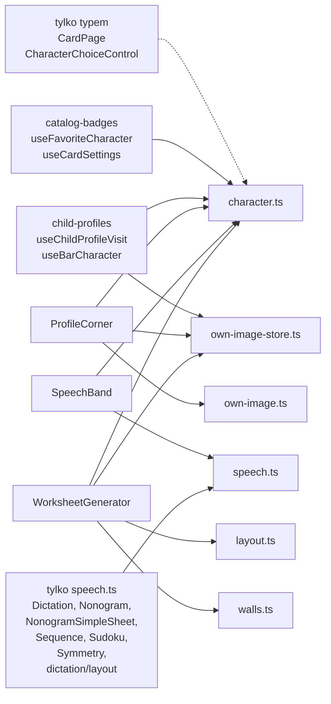

# Kto zależy od `src/lib/sheet`

SVG: `context/map/kto-zalezy-od-sheet.svg`. Silnik to `@hpcc-js/wasm-graphviz` (Graphviz w WebAssembly), zainstalowany w katalogu tymczasowym poza repo. Systemowego `dot` nie ma.

Źródło krawędzi: `dependency-cruiser src` z `--focus "^src/lib/sheet/"`, `--focus-depth 1`, `--include-only "^src/"` i bez plików testowych. Na rysunku zostały tylko strzałki wchodzące do `src/lib/sheet`. Połączenia między sąsiadami (generator → `CardPage`, profil → `child-profiles`) są zdjęte. Moduły, które celują w ten sam zestaw plików arkusza, stoją w jednym prostokącie. Linia przerywana to import samego typu.

Poza rysunkiem katalog sam zależy od `last-used.ts` (`own-image-store.ts`) i typem od `maze/generate.ts` (`walls.ts`). Wewnątrz katalogu `own-image-store.ts` importuje `character.ts`.

