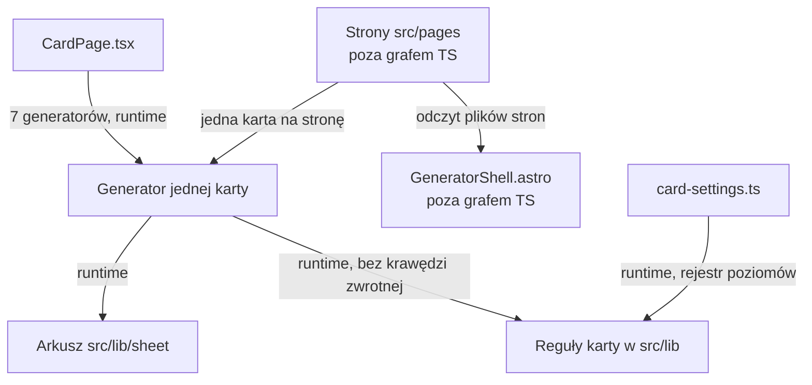

# Mapa repozytorium PrintoKids

## TL;DR

PrintoKids składa kartki A4 do druku dla dziecka: labirynt, sudoku, symetrię, dyktando, nonogram, sekwencje i pieniądze. Katalog jest stroną główną, a profil dziecka i ostatnie ustawienia kart zostają w przeglądarce. Cała historia `main` mieści się w niecałych sześciu tygodniach (27 września – 2 listopada 2026): 257 commitów ruszyło kod produktu, każdy podpisany przez drpc1, każdy ze współautorem-agentem w stopce. Ruch skupia się na tym, co powstało pierwsze (labirynt, druk A4, profil), i na fali nowych kart z dwóch ostatnich tygodni, kiedy tydzień urósł z 29 przez 77 do 117 commitów. Boli profil: najwyższy udział poprawek wśród pięciu najaktywniejszych obszarów oraz zapis w `localStorage`, którego graf importów nie rysuje, przy hubie `card-settings.ts` wciągającym poziomy każdej karty. Reguły labiryntu są liściem grafu, a 48 commitów w `WorksheetGenerator.tsx` w większości opisuje czas przed przeniesieniem Generuj i Drukuj do `CardPage`. Szablony kształtów (`symmetry/templates.ts`, 20 importerów) spinają dyktando, nonogram i sąsiednie karty mocniej, niż widać to w parach współzmian.

Strzałki stron pochodzą z odczytu plików `.astro`. Reszta jest z grafu importów runtime. Warstw bez tego grafu (Astro, CSS, `localStorage`) ten rysunek nie domyka — to unknown, opisane niżej.

## Teren

Duża odpowiedzialność produktu siedzi w trzech miejscach, które historia zna od pierwszych kampanii: generowanie labiryntu, druk arkusza A4 i profil dziecka. Wokół nich, od 19 października, doszła fala kart (symetria, sudoku, sekwencje, nonogram, dyktando) i katalog jako strona główna. Peryferie to karta pieniędzy (4 commity, jeden temat `coins-who-has-more`), dialog i tokeny wyglądu — oba wygasają. Powłoka `CardPage` jest wspólną odpowiedzialnością Generuj / Drukuj, a w historii ma 8 commitów, wszystkie z kampanii `gh192-pages-sceleton` po 30 października.

Krytyczność poniżej jest wnioskiem z kolejności produktu w historii i z tego, jak daleko moduł sięga w grafie. Osobnej, wcześniejszej punktacji zdolności te trzy artefakty nie zawierają. Tarcie na GitHubie (zero revertów, zero otwartych zgłoszeń z etykietą `bug`, jeden celowo czerwony PR #15) nie rozróżnia obszarów. Rund recenzji w materiałach nie ma.

| Obszar | Rola | Krytyczność | Zmiana | Poprawki | Zasięg | Trend | Gdzie żyje |
| --- | --- | --- | --- | --- | --- | --- | --- |
| Labirynt | Karta labiryntu | wysoka | 62, stałe 8–17 tygodniowo | 16%; kilka usterek rysunku, reszta to przegląd albo `phone-worksheet` | `maze/generate.ts` stożek 1; komponent stożek 44 | stały | `src/lib/maze/`, `src/components/WorksheetGenerator.tsx`, `src/pages/maze.astro` |
| Profil dziecka | Profile, ostatnie ustawienia, ulubiona postać | wysoka | 58 | 21%, najwyższy z pięciu; nieświeży zapis | hub 16 modułów; róg stożek 31; `localStorage` poza grafem | rosnący, szczyt 36 w ostatnim tygodniu | `src/lib/child-profiles.ts`, `src/lib/card-settings.ts`, `src/components/ProfileCorner.tsx`, hooki wizyty i paska |
| Druk A4 | Milimetry, ściany, chrome wydruku | wysoka | 54 | 17%; cztery z dziewięciu to druk z telefonu | `layout.ts` ma jednego klienta produkcyjnego | rosnący | `src/lib/sheet/layout.ts`, `src/lib/sheet/walls.ts`, `src/components/GeneratorShell.astro` |
| Katalog | Wejście i lista kart | średnia | 45 | 16%, w większości rozlanie z innych kart | `cards.ts` bez lokalnych importów | rosnący razem z falą kart | `src/lib/cards.ts`, `src/pages/index.astro`, `src/components/CardCatalog.astro` |
| Symetria | Karta i katalog szablonów | średnia | 42 | 12%, cztery z pięciu to przegląd premiery | `templates.ts`: 20 importerów | rosnący, premiera | `src/lib/symmetry/`, `src/components/SymmetryGenerator.tsx` |
| Sudoku | Sudoku obrazkowe | średnia | 40 | w premierze, nie w tabeli pięciu | generator stożek 54; kształty bierze też sekwencja | rosnący, premiera | `src/lib/sudoku/`, `src/components/SudokuGenerator.tsx` |
| Sekwencje, nonogram, dyktando | Trzy karty z tej samej fali | średnia | 28, 25, 22 | poza piątką najaktywniejszych | każda ciągnie cudzy moduł, patrz powiązania | rosnący, premiera | `src/lib/sequence/`, `src/lib/nonogram/`, `src/lib/dictation/` i generatory obok |
| Pieniądze | „Kto ma więcej” | niska | 4 | — | `generate.ts` stożek 2, woła losowość sekwencji | sezon | `src/lib/money/`, `src/components/MoneyGenerator.tsx` |
| Postać na karcie | Postać, własny obrazek, pasek | średnia | 24 | — | `character.ts` stożek 0; wołają go profil i labirynt | sezon, szczyt z ulubioną | `src/lib/sheet/character.ts`, `src/lib/sheet/own-image-store.ts` |
| Powłoka karty | Wspólne Generuj, Drukuj, pasek | wysoka jako kontrakt, mało historii | 8 | — | `CardPage` stożek 34; nie importuje reguł kart | sezon od 30.10 | `src/components/CardPage.tsx`, `src/hooks/useCardPage.ts` |

Stożek to liczba modułów `src` osiągalnych importem runtime. Szerokie złożenie to generatory (labirynt 44, sudoku 54, symetria 52, dyktando 53, sekwencje 55, nonogram 56, pieniądze 49) i róg profilu (31): montują React, arkusz i rejestr. Wąskie liście to miejsce reguł: `maze/generate.ts` (1), `sudoku/generate.ts` (2), `money/generate.ts` (2) oraz `layout.ts`, `speech.ts`, `character.ts` i `cards.ts` (0). Mały stożek znaczy, że zachowanie mieszka w tym pliku — test Node leży obok `generate.ts`. Cienkie wejścia to strony: 11–14 linii, `GeneratorShell`, jeden generator, tytuł z `cards.ts`. W cruiserze `src/pages` ma 0 modułów.

Tydzień produktu, od startu: 1, 12, 19, 29, 77, 117 commitów. Labirynt bezwzględnie zostaje przy 8–17; jego udział spada, bo tydzień urósł. Profil, druk, katalog i cała fala kart rosną. Dialog i wygląd gasną; szczyt wyglądu (6 z 6 commitów jednego tygodnia) to temat `phone-worksheet`. W poniedziałek 2 listopada kod produktu na `main` nie ruszył.

Katalogi nie są zdolnościami. `src/components` (122 commity) trzyma naraz labirynt, pozostałe generatory, róg profilu i powłokę. `src/lib/sheet` (55) to jednocześnie milimetry, ściany, kwestia mówiona, postać i własny obrazek. Labirynt jest rozcięty: generowanie i poziomy w `src/lib/maze`, milimetry i ściany w arkuszu, rysunek SVG w `WorksheetGenerator.tsx`. Plików `maze/sheet.ts` i `maze/layout.ts` nie ma. Katalog nie ma własnego katalogu z logiką: lista jest w `cards.ts`, obrazki dopisuje skrypt, a ruch e2e siedzi w `tests/e2e/catalog.spec.ts`. Układ telefonu żyje w specu i w poprawkach innych obszarów, nie w jednym folderze.

Stare ścieżki są już złożone do dzisiejszych nazw: `labirynt.astro` → `maze.astro`, `dyktando.astro` → `dictation.astro`, `sekwencje.astro` → `sequences.astro`, `symetria.astro` → `symmetry.astro`, `WorksheetHome.astro` → `GeneratorShell.astro`, `SequenceLevelChoice.tsx` → `LevelChoice.tsx`. `useScrollEdges.ts` zniknął bez uznanego rename; zastępuje go `useScrollIndicator.ts`.

## Realne powiązania

Cyklów nie ma. Graf `src` + `tests` (387 importów runtime, 54 krawędzie samych typów) i osobny graf `scripts/` (140 zależności) mają 0 pętli. `scripts/smoke.mjs` jest sierotą, bo nikt go nie importuje: to wejście skryptu.

**Graf i historia mówią to samo.** Generator labiryntu importuje `sheet/layout.ts`, `sheet/walls.ts` i `useChildProfileVisit.ts`. Te moduły nie importują generatora z powrotem. Para druk + labirynt to 24 commity, 51% druku po odcięciu commitów o pięciu i więcej obszarach — najsilniejsza para w historii. Pliki tej pary: `WorksheetGenerator.tsx` (22), `print-contract.test.ts` (10), `GeneratorShell.astro` (9), `layout.test.ts` (7), `layout.ts` (4). Źródło pary: git. Źródło kierunku: graf importów. Sąsiedztwo samego arkusza (14 strzałek wchodzących, nie całe `src`) jest narysowane w [kto-zalezy-od-sheet.svg](kto-zalezy-od-sheet.svg): `layout.ts` i `walls.ts` mają jednego klienta, `WorksheetGenerator`; `speech.ts` biorą generatory poza labiryntem i pieniędzmi.

**Graf pokazuje sprzężenie, którego pary gita nie wynoszą na górę.** W runtime: `dictation/generate.ts` i `nonogram/generate.ts` importują `symmetry/templates.ts` (20 importerów, w tym `CategoryChoice.tsx`, `card-settings.ts`, `card-summary.ts`); `sequence/shapes.ts` importuje `sudoku/shapes.ts`; `money/generate.ts` importuje `sequence/random.ts`; `NonogramGenerator.tsx` importuje `SudokuChoice.tsx`, a ta kontrolka nie importuje `src/lib/sudoku`. Źródło: graf. Po cięciu commitów o pięciu i więcej obszarach te pary nie wchodzą do tabeli współzmian. Pytanie do późniejszego czytania: zmiana szablonu symetrii rusza dyktando i nonogram, a historia tego nie podświetla.

**Historia pokazuje sprzężenie, którego graf nie ma.** `localStorage` wołają wprost `ProfileCorner.tsx`, `WorksheetGenerator.tsx`, `useCardSettings.ts`, `useChildProfileVisit.ts`, `useFavoriteCharacter.ts` i `useBarCharacter.ts`. Funkcje biblioteki biorą magazyn jako argument, więc cruiser tej krawędzi nie ma. To unknown grafu, a wołania są wypisane z odczytu. Git widzi skutek: labirynt + profil, 18 commitów (35% profilu); postać + profil, 8 commitów (40% postaci), na plikach `child-profiles`, `own-image-store`, `character`.

**Rejestr, zamierzony.** `card-settings.ts` i `card-summary.ts` w runtime zbierają `levels.ts` każdej karty, `nonogram/sizes.ts` oraz `symmetry/levels.ts` i `symmetry/templates.ts`. Szesnaście modułów stożka `card-settings.ts` to właśnie te pliki. Przez hub do profilu, `last-used.ts`, `own-image-store.ts` i `catalog-badges.ts` wchodzą reguły kart, choć sam profil ich nie rysuje. `last-used.ts` ma jednego sąsiada: `card-settings.ts`. `cards.ts` nie ma lokalnych importów; w grafie TS biorą go `card-summary.ts` i testy. Źródło: graf. To rejestr danych, nie złamanie granicy. Strażnik: `card-settings.test.ts` i spec `card-settings.spec.ts`.

**Kierunek, który trzyma się w kodzie produkcyjnym.** Z modułów kart do `components` / `hooks` / `pages` idzie zero krawędzi (40 krawędzi w drugą stronę). `CardPage.tsx`, `useCardPage.ts`, `GenerateButton.tsx`, `ProfileCorner.tsx`, `CatalogProfileCorner.tsx` i hooki paska nie importują katalogów reguł. Do `sheet` wchodzi 15 importów runtime z komponentów i 6 z modułów kart. Odwrotnie, tylko testy: `layout.test.ts` → `maze/levels.ts`, `walls.test.ts` → `maze/generate.ts`, `speech.test.ts` → `sheet.ts` dyktanda, nonogramu, sekwencji, sudoku i symetrii. Żaden test Node nie importuje generatora, `CardPage`, `ProfileCorner` ani `dialog`. Montowanie generatora albo rogu profilu jest warstwą Playwrighta (`level-bar`, `card-settings`, `phone-layout`, `profile-summary`, `print-margins`). Specy są w cruiserze jako pliki i nie importują komponentów — pokrycie UI nie jest krawędzią.

**Same typy, 54 krawędzie.** Nie liczą się jako złamanie granicy ani jako moduł stożka. Przez granicę karty albo arkusza m.in. `walls.ts` → `maze/generate.ts`, poziomy i szablony dyktanda i nonogramu → symetria, każdy generator → `card-settings.ts`, `CardPage.tsx` → profil, ustawienia i `character.ts` (typ), `ProfileCorner.tsx` → `card-settings.ts`.

**Przez regenerację albo przez pilnowany workflow — tańsze niż ręczny kontrakt.**

- SVG w `public/thumbnails/` powstają z `scripts/build-thumbnails.mjs`. Każdy plik miniatury ma 1–3 commity i wraca ze swoją kartą. Para katalog + skrypty (9 commitów, 43% skryptów) jest tym korytarzem. Źródło: git; skrypt w grafie `scripts/`, miniatury poza nim.
- `print-contract.test.ts` importuje tylko `node:assert`, `node:fs`, `node:path` i `node:url` i czyta źródła z dysku. 31 commitów i 14 obszarów to ręczna lista ścieżek, a test jest strażnikiem: rozjazd ścieżki wybucha w teście, nie w imporcie. Źródło grafu: brak krawędzi wewnętrznej. Źródło licznika: git.
- `package.json` (47 commitów obok kodu, 16 obszarów) i `scripts/smoke.mjs` (9 commitów, 12 obszarów) to ręcznie dopisywane listy: pliki w polu `scripts.test`, zdania na stronach. `smoke.mjs` jest sierotą grafu. `cards.ts` (`CARD_KINDS`, 8 commitów, 10 obszarów) jest takim samym rejestrem.
- `global.css` (17 commitów, 7 obszarów) nie jest modułem biegu cruisera. Lockfile schodzi się z kodem w 3 commitach, `wrangler.jsonc` w jednym.

**Warstwy bez grafu — unknown, nie „brak powiązań”.** Cruiser rozwiązuje `.ts`, `.tsx` i `.d.ts`. `src/pages` i `GeneratorShell.astro` mają w tym biegu 0 modułów; z odczytu stron wiadomo tylko, że powłoka importuje `SiteFooter.astro`, a strona karty składa powłokę, jeden generator i tytuł. `how-it-works.astro` woła `cardsInCatalogOrder()`. `CardCatalog.astro` importuje `cards.ts` i w skrypcie `catalog-badges.ts`. Żadna strona nie importuje `generate`, `layout` ani `sheet` — to wynika z odczytu, nie z cruisera. CSS, treść SVG w `WorksheetGenerator.tsx` i wołania `localStorage` są poza grafem. Czternaście trafień `dist` w rozwiązanych ścieżkach to wejścia paczek w `node_modules`, nie katalog builda projektu.

## Strefy ryzyka

### Profil dziecka

Zapis ustawień i ulubionej jest miejscem, w którym produkt już gubił stan, a narzędzie zależności tego kontraktu nie pokazuje.

Dwa niezależne sygnały. Poprawki, z historii: 12 z 58 commitów (21%, najwyżej w piątce); w tematach zostają poziom sudoku przy 4×4, zapis ulubionej czytany z nieświeżego stanu i róg na katalogu, który nie odświeżał się przy powrocie (`gh234`). Zasięg, z grafu i z listy wołań: `card-settings.ts` w runtime zbiera poziomy każdej karty (stożek 16), `ProfileCorner.tsx` ma stożek 31, a sześć modułów woła `localStorage` wprost. Szczyt 36 commitów w tygodniu 26 października – 1 listopada to ta sama kampania co te poprawki (`card-settings-memory`, `gh237-maze-level`, `favorite-character-explicit`). Liczona raz, nie jako trzeci głos.

Gdzie żyje: `src/lib/child-profiles.ts`, `src/lib/active-profile.ts`, `src/lib/card-settings.ts`, `src/lib/last-used.ts`, `src/components/ProfileCorner.tsx`, `src/components/CatalogProfileCorner.tsx`, `src/hooks/useChildProfileVisit.ts`, `src/hooks/useCardSettings.ts`, `src/hooks/useFavoriteCharacter.ts`, `src/hooks/useBarCharacter.ts`, `src/lib/sheet/character.ts`, `src/lib/sheet/own-image-store.ts`, `src/lib/catalog-badges.ts`.

### Na oku

**Składanie labiryntu na arkusz A4.** Najwyższa para współzmian (51% druku) i jedyny produkcyjny klient `layout.ts` oraz `walls.ts`. Do strefy ryzyka nie wchodzi: stożek geometrii jest 0, a duży kawałek licznika druku to `print-contract.test.ts` i temat `phone-worksheet` (ten sam, który podbija telefon, wygląd i dialog). Zostają prawdziwe usterki kartki — wspólna ściana rysowana dwa razy, brak przegenerowania po zmianie poziomu, druk z telefonu, limit 108vh — przy powłoce `.astro`, której graf nie obejmuje. Gdzie żyje: `src/components/WorksheetGenerator.tsx`, `src/components/GeneratorShell.astro`, `src/lib/sheet/layout.ts`, `src/lib/sheet/walls.ts`, `src/lib/maze/generate.ts`, `src/lib/maze/levels.ts`, `src/pages/maze.astro`.

**Wspólne kształty kart.** `symmetry/templates.ts` ma 20 importerów, a dyktando, nonogram, sekwencje i pieniądze sięgają poza własny folder (graf, wyżej). Commity tych kart są wysokie, bo to premiera z dwóch tygodni — jedna przyczyna, nie osobny głos. Pary gita tego sięgnięcia nie podświetlają. Gdzie żyje: `src/lib/symmetry/templates.ts`, `src/lib/dictation/generate.ts`, `src/lib/nonogram/generate.ts`, `src/lib/sequence/shapes.ts`, `src/lib/sudoku/shapes.ts`, `src/lib/money/generate.ts`, `src/lib/sequence/random.ts`, `src/components/NonogramGenerator.tsx`, `src/components/SudokuChoice.tsx`.

### Wygląda groźnie, ale nie jest

- **`print-contract.test.ts`** — 31 commitów, 14 obszarów. Czyta źródła z dysku i sam jest strażnikiem ścieżek. Podbija „druk” i parę z labiryntem.
- **`package.json` i `scripts/smoke.mjs`** — listy dopisywane przy każdej nowej stronie. Config zapisany jako kod; `smoke.mjs` jest wejściem, nie hubem architektury.
- **Miniatury** — `scripts/build-thumbnails.mjs` (19 commitów, 11 obszarów) generuje SVG. Współzmiana katalogu ze skryptami to regeneracja, nie ręczna edycja obrazków. Poprawki katalogu w większości ruszają właśnie miniatury albo `cards.ts`.
- **`cards.ts`** — rejestr `CARD_KINDS`. Szeroki dotyk przy małym pliku jest zamierzony.
- **`phone-worksheet`** — jeden temat tłumaczy poprawki druku, profilu, labiryntu oraz szczyt wyglądu i sezon dialogu. Liczony raz.
- **Udział `fix` przy symetrii** — cztery z pięciu to przegląd premiery, piąty to wcięcie przełącznika. Tak wygląda oddawanie nowej karty.
- **48 commitów `WorksheetGenerator.tsx`** — większość sprzed 30 października 2026, kiedy wspólne Generuj i Drukuj przeszły do `CardPage`. Plik zostaje kartą labiryntu; licznik opisuje też starą stronę.
- **Trafienia `dist` i PR #15** — `dist` należy do paczek w `node_modules`. PR #15 celowo psuł test, żeby czerwone CI blokowało merge, i został zamknięty bez scalenia.
- **Jedna osoba i 96% commitów ze stopką agenta** — przy zespole jednej osoby skupienie jest normą. Claude i Cursor w `Co-authored-by` nie są drugim człowiekiem.

## Kogo zapytać

W oknie jest jedna osoba: **drpc1** (651 commitów z noreply GitHuba, 7 z poczty przy `nonogram-sizes`; pliku `.mailmap` nie ma). Przy jednej osobie nie ma kogo zestawić. Poniżej ta sama osoba i tematy, po których widać dany obszar w `git log`. Agenci ze stopki nie są kontaktem.

| Strefa | Kto | Tematy w historii |
| --- | --- | --- |
| Profil dziecka | drpc1 | `child-profile-create-select`, `child-profile-save-delete`, `card-settings-memory`, `gh237-maze-level`, `gh234-profile-on-homepage`, `favorite-character-explicit`, `gh167-favourite-character` |
| Labirynt na A4 (na oku) | drpc1 | `first-printable-maze`, `print-a4-maze`, `print-sheet-contract`, `printed-maze-equal-margins`, `phone-worksheet`, `print-printer-margins`, `gh192-pages-sceleton` |
| Wspólne kształty (na oku) | drpc1 | `template-object-catalog`, `symmetry-first-printable`, `picture-sudoku-first-printable`, `sudoku-shape-list`, `sequences-first-printable`, `nonogram-first-printable`, `graphic-dictation-first-printable` |

Log mówi, które tematy drpc1 ruszał. Nie mówi, co z nich zostało w pamięci.

## Pierwszy dzień

Kolejność od rejestru produktu do miejsca, które boli.

1. `src/lib/cards.ts` — lista kart. Brak lokalnych importów; to ręczny rejestr, od którego startuje katalog.
2. `src/pages/index.astro` — strona główna. Cienkie złożenie katalogu; graf TS jej nie widzi.
3. `src/components/CardPage.tsx` — wspólne Generuj, Drukuj i pasek. Importuje siedem generatorów i nie sięga do reguł kart. Historia ma tu 8 commitów, bo powłoka jest świeża.
4. `src/components/GeneratorShell.astro` — chrome kartki. Poza grafem TS; z odczytu stron importuje tylko `SiteFooter.astro`.
5. `src/components/WorksheetGenerator.tsx` — karta labiryntu i największy plik historii. Składa reguły, milimetry, ściany i wizytę profilu; SVG cruiser pomija.
6. `src/lib/maze/generate.ts` — samo generowanie. Stożek 1, test Node obok pliku. Reszta „labiryntu” w sensie commitów tu nie mieszka.
7. `src/lib/sheet/layout.ts` — geometria A4. Stożek 0, jeden klient produkcyjny: generator labiryntu. Ściany są w `src/lib/sheet/walls.ts`.
8. `src/lib/card-settings.ts` — hub zapisu ustawień. W runtime zbiera poziomy wszystkich kart. Dalej: `src/lib/child-profiles.ts` i `src/components/ProfileCorner.tsx`.

Potem, jeśli zmiana dotyczy kształtu a nie labiryntu: `src/lib/symmetry/templates.ts`.

## Ograniczenia

Okno to cała linia `main`: pierwszy commit 27 września 2026, ostatni ruch 2 listopada 2026, HEAD `88602e1`. Historia jest krótsza niż rok, więc mapa nie rozróżnia „ostatnich 12 miesięcy” od „od zawsze”. Liczone są commity bez scalających (658), po filtrach 635; kod produktu ruszyło 257. Commit wchodzi do obszaru raz. Czysty rename nie podbija licznika. Z par współzmian wycięte jest 16 commitów, które naraz ruszyły pięć lub więcej obszarów, dlatego procenty par mają niższe mianowniki niż tabela obszarów.

Źródła to trzy artefakty z gita i dependency-cruisera. Osobnego przeglądu dyskusji (rundy recenzji, komentarze, drugi przebieg PR) nie ma. Z forga w materiałach zostaje tylko: PR #15, jedenaście zamkniętych zgłoszeń z etykietą `bug`, sześć otwartych issues jako plasterki roadmapy. Graf: TypeScript i TSX w `src` i `tests` oraz osobno `scripts/`. Astro, strony, CSS, SVG i `localStorage` są unknown. Specy Playwright nie dają krawędzi do komponentów.

Mapa nie mówi, czy labirynt na kartce jest rozwiązywalny, jak zachowuje się druk w przeglądarce, ani co autor pamięta. Nie ma w niej konsumentów spoza repozytorium. Nie rozstrzyga, jak daleko zmiana `symmetry/templates.ts` zmienia wydruk dyktanda i nonogramu — graf pokazuje import, nie skutek na kartce. Krytyczność w tabeli terenu jest wnioskiem z tych artefaktów, nie osobnym scoringiem.

Warte osobnego czytania: kontrakt kluczy `localStorage` między sześcioma wołaniami; powłoka `.astro`, której cruiser nie rozwiązuje; sięgnięcie dyktanda i nonogramu do szablonów symetrii przy cichej historii współzmian.
