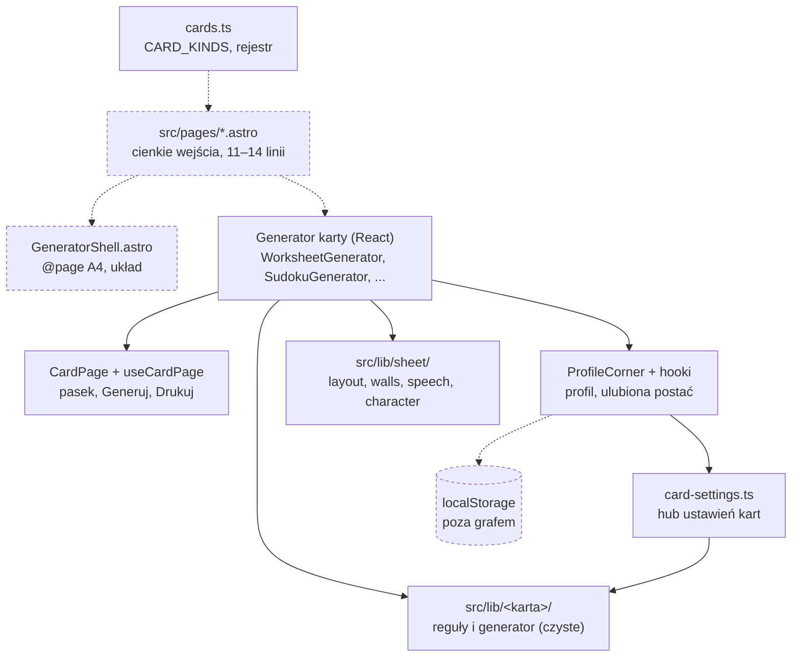

# Mapa repozytorium PrintoKids (v2)

Złożona z trzech artefaktów: [terytorium](artifact-1-territory.md), [struktura](artifact-2-structure.md), [kontrybutorzy](artifact-3-contributors.md). Liczby pochodzą stamtąd; tu je łączę i oceniam. Wycinek grafu: [kto-zalezy-od-sheet.svg](kto-zalezy-od-sheet.svg).

Znaczniki przy sprzężeniach, czyli skąd to wiem:

- **[graf]** krawędź importu z dependency-cruisera (`src` + `tests`, 188 modułów).
- **[git]** zmieniane razem w commitach `main`. Dowodzi nawyku pracy, nie zależności w kodzie.
- **[poza grafem]** obszar, którego narzędzie nie objęło. To jest *unknown*, a nie „brak powiązań”.
- **[regeneracja]** zmienia się razem, bo jest generowane. Tańsze niż ręczna edycja.

## 1. TL;DR

PrintoKids to Astro 7 SSR z wyspami React: generuje rozwiązywalną kartę A4 (labirynt i dziewięć innych rodzajów, razem dziesięć), pokazuje podgląd i drukuje. Dane dziecka i ustawienia zostają w `localStorage`. Reguły każdej karty są w czystych modułach `src/lib/<karta>/` z testami `node:test`. Wspólny arkusz A4 siedzi w `src/lib/sheet/`. Cienka powłoka `CardPage` składa pasek, Generuj i Drukuj. Praca skupiła się na labiryncie, profilu dziecka i druku, a od 19 października na kolejnych kartach (symetria, sudoku, sekwencje). Boli na styku profilu, druku i telefonu oraz w wielkich komponentach bez testów jednostkowych. Całą historię (5 tygodni) napisała jedna osoba z agentami.

Linie przerywane to krawędzie, których cruiser nie widzi (pliki `.astro` i `localStorage` wypadają z grafu). Znam je z lektury plików i z listy plików w commitach, nie z grafu.

## 2. Teren

**Duża odpowiedzialność (dużo zmian, dużo zależności):**

- Labirynt: 62 commity, z czego 48 w jednym pliku, `WorksheetGenerator.tsx`. Większość sprzed 30 października, zanim wspólne Generuj, Drukuj i wiersz ustawień przeszły do `CardPage` (kampania `gh192-pages-sceleton`). Dziś to głównie historia, nie bieżąca prędkość.
- Profil dziecka: 58 commitów, w tygodniu 26.10–1.11 aż 36 (`card-settings-memory`, `gh237-maze-level`, `favorite-character-explicit`).
- Druk A4: 54 commity, stale 5–19 tygodniowo.

**Rosnące od 19 października:** katalog, symetria, sudoku, sekwencje, nonogram, dyktando, układ na telefonie. Tydzień urósł z 12 do 117 commitów. To rytm kampanii „kolejna karta”, nie ciągły trend; okno jest za krótkie, żeby to nazwać trendem.

**Peryferia:** pieniądze (4 commity, jedna kampania `coins-who-has-more`), `CardPage` / sterowanie (8 commitów, ale to nowa powłoka pod pięcioma kartami).

**Wygasające:** dialog i wygląd (sezon października, głównie `phone-worksheet`).

**Głębokie vs płytkie moduły [graf]:**

- *Głębokie i czyste:* generatory kart (`maze/generate.ts`, `sudoku/generate.ts`, `money/generate.ts` mają zamknięcie 1–2 modułów). Reguły kart nie importują komponentów (0 krawędzi wstecz).
- *Płytkie i ciężkie:* komponenty generatorów (zamknięcie runtime 44–56 modułów) oraz `ProfileCorner.tsx` (31). Montują React, arkusz i rejestr naraz.
- *Hub:* `card-settings.ts` ma zamknięcie 16 modułów (poziomy i szablony wszystkich kart). Przez niego profil „widzi” reguły kart, choć ich nie rysuje.

**Gdzie struktura katalogów kłamie:**

- Obszar „druk A4” nie ma własnego katalogu. To `sheet/layout.ts`, `GeneratorShell.astro`, test `print-contract.test.ts` i spec Playwrighta naraz.
- `src/lib/sheet/` wygląda na wspólny arkusz, ale `layout.ts` i `walls.ts` mają jednego klienta: labirynt. Pozostałe karty biorą z niego prawie tylko `speech.ts`.
- `src/lib/symmetry/templates.ts` to de facto wspólny katalog obiektów dla trzech kart, a leży w katalogu symetrii.
- Labirynt nie ma `maze/sheet.ts` ani `maze/layout.ts`. Jego SVG jest w komponencie, którego graf nie czyta.

## 3. Realne powiązania

**Co zmienia się razem [git]** (po odjęciu 16 commitów dotykających 5+ obszarów naraz):

| Para | Razem | Udział | Wniosek |
| --- | ---: | --- | --- |
| Druk A4 + Labirynt | 24 | 51% druku | Jedyna mocna para. Wspólne pliki: `WorksheetGenerator.tsx`, `print-contract.test.ts`, `GeneratorShell.astro`, `layout.ts`. |
| Labirynt + Profil | 18 | 35% profilu | `WorksheetGenerator.tsx` ↔ `ProfileCorner.tsx`, `child-profiles.ts`. |
| Katalog + Skrypty | 9 | 43% skryptów | Patrz „wygląda groźnie”: lista ręczna plus miniatury [regeneracja]. |
| Postać + Profil | 8 | 40% postaci | `character.ts`, `own-image-store`. |

**Co zależy od czego [graf]:**

- 0 cykli w `src` i `tests` oraz w `scripts/`. Granice trzymają: reguły kart nie importują komponentów, a powłoka (`CardPage`, `ProfileCorner`, `useCardPage`) nie importuje reguł konkretnej karty.
- Zaskoczenie wobec tabeli współzmian: **ukryte krawędzie między kartami w runtime.** `dictation/generate.ts` i `nonogram/generate.ts` → `symmetry/templates.ts` (20 importerów). `sequence/shapes.ts` → `sudoku/shapes.ts`. `money/generate.ts` → `sequence/random.ts`. `NonogramGenerator.tsx` → `SudokuChoice.tsx`. Te karty nie są niezależne, choć wyglądają jak osobne moduły. Git tego nie pokazuje, bo to różne tygodnie pracy.
- `speech.ts` (arkusz) ma 14 importerów: wszystkie karty poza labiryntem i pieniędzmi.
- Granica `sheet` ↔ karty jest czysta w kodzie produkcyjnym, a w testach przebita: `speech.test.ts` importuje `sheet.ts` pięciu kart, `walls.test.ts` importuje `maze/generate.ts`. [graf]

**Co graf pomija [poza grafem], czyli unknown, nie „brak powiązań”:**

- Wszystkie `src/pages/*.astro` i `GeneratorShell.astro` (cruiser nie rozwiązuje `.astro`). Wiemy tylko z lektury, że strony są cienkie.
- `localStorage`: czytają go wprost `ProfileCorner`, `WorksheetGenerator`, `useCardSettings`, `useChildProfileVisit`, `useFavoriteCharacter`, `useBarCharacter`. Krawędzi nie ma, a tu leży `gh234` (nieświeży róg profilu) i inne `fix` profilu.
- `print-contract.test.ts` czyta źródła z dysku i nie importuje niczego lokalnego. Zmiana ścieżki psuje go bez krawędzi. To ukryte sprzężenie, ale chcianie.
- `global.css`, specy Playwright (nie importują komponentów). Pokrycie UI labiryntu siedzi w specach o innych nazwach (`level-bar`, `card-settings`, `phone-layout`, `print-margins`, `catalog`).

**Zmiana „przez regenerację” [regeneracja]:** SVG w `public/thumbnails/` zapisuje `scripts/build-thumbnails.mjs`; każdy plik ma 1–3 commity i wraca razem ze swoją kartą. Nie mierzy to kosztu ręcznej edycji. Mocków w artefaktach nie wykryto; ich nieobecność nie jest dowodem, że ich nie ma.

## 4. Strefy ryzyka

Każda ma co najmniej dwa niezależne sygnały. Gdzie jedyny sygnał to „dużo commitów”, strefy nie ma (patrz sekcja „wygląda groźnie”).

1. **Druk arkusza A4, zwłaszcza z telefonu.** Żyje w: `src/lib/sheet/layout.ts`, `src/components/GeneratorShell.astro`, `src/lib/sheet/print-contract.test.ts`, `tests/e2e/print-margins.spec.ts`.
   Dlaczego: 4 z 9 `fix` to druk z telefonu (Safari/iOS, limit 108vh), a para z labiryntem [git] schodzi się w 51% commitów druku. Do tego logika `@page` siedzi w pliku `.astro`, którego graf nie widzi [poza grafem].

2. **Profil dziecka i pamięć ustawień kart.** Żyje w: `src/lib/child-profiles.ts`, `src/lib/card-settings.ts`, `src/lib/last-used.ts`, `src/components/ProfileCorner.tsx`, `src/hooks/useChildProfileVisit.ts`.
   Dlaczego: najwyższy udział poprawek (12 z 58, 21%: nieświeży stan, poziom sudoku zostający przy 4×4), a `card-settings.ts` jest hubem o zamknięciu 16 modułów [graf] i czyta `localStorage` poza grafem. `ProfileCorner` ma zamknięcie 31 i żaden test Node go nie importuje; chroni go tylko Playwright.

3. **Generowanie labiryntu i jego komponent.** Żyje w: `src/lib/maze/generate.ts`, `src/lib/maze/levels.ts`, `src/components/WorksheetGenerator.tsx`.
   Dlaczego: jeden plik (48 commitów, 13 obszarów, zamknięcie 44) łączy generator, rysunek SVG, profil i druk, a SVG jest poza zasięgiem cruisera. Sam generator (`maze/generate.ts`) jest czysty i dobrze izolowany; ryzyko siedzi w komponencie. Część churnu jest historyczna (sprzed `gh192`).

4. **Katalog szablonów obiektów (symetria → nonogram, dyktando).** Żyje w: `src/lib/symmetry/templates.ts`, `src/lib/dictation/generate.ts`, `src/lib/nonogram/generate.ts`.
   Dlaczego: 20 importerów [graf], w tym ukryte krawędzie z innych kart, a git pokazuje serię kampanii dopisujących obiekty i kategorie (`gh198`, `gh124`, `gh115`, `gh118`). Nowy obiekt może złamać regułę obrysu dyktanda albo jedno rozwiązanie nonogramu, które sprawdza osobny generator.

5. **Katalog kart i rejestr rodzajów.** Żyje w: `src/lib/cards.ts` (`CARD_KINDS`), `src/components/CardCatalog.astro`, `src/lib/catalog-badges.ts`, `src/pages/index.astro`, `src/pages/how-it-works.astro`.
   Dlaczego: 7 `fix` (16%), z czego większość to przeglądy innych kart dotykających `cards.ts`; rejestr jest dopisywany ręcznie przy każdej nowej karcie (10 obszarów). `cards.ts` nie ma lokalnych importów, więc graf nie ostrzeże, że nowa karta o czymś zapomniała [poza grafem dla stron].

Nie uczyniłem strefą ryzyka powłoki `CardPage` / `useCardPage` (zamknięcie 34, siedem generatorów od niej zależy, bez testów Node), bo ma jeden sygnał: świeżość migracji `gh192` (8 commitów). Warto ją obserwować, nie nazywać strefą.

### Wygląda groźnie, ale nie jest

| Sygnał | Przyczyna |
| --- | --- |
| `package.json`: 47 commitów, 16 obszarów | Ręczna lista plików w `scripts.test`; workflow wymaga dopisania nowego testu. Jedna przyczyna. |
| `print-contract.test.ts`: 23–31 commitów, 14 obszarów | Test-strażnik z ręcznymi stałymi ścieżek stron i generatorów; schodzi się z każdą nową stroną z konstrukcji. To zabezpieczenie, nie defekt. (Mechanizm sprzężenia ze strefą 1 pozostaje.) |
| `build-thumbnails.mjs`, `public/thumbnails/*`, `smoke.mjs` | Ręczne listy kart plus SVG zapisywane skryptem [regeneracja]. Jeden cykl „nowa karta”. |
| 14 trafień `dist` w grafie | Wejścia paczek w `node_modules` (`lucide-react`, `radix-ui` i inne), nie katalog builda. |
| 0 cykli, 54 krawędzie tylko-typowe | Brak pętli. Importy typów przez granice nie są złamaniem granic. |
| PR #15 zamknięty bez merge'a | Celowo czerwony test, który sprawdza, czy `CI / ci` blokuje merge. Nie jest porażką. |
| Czerwone commity `fix(phone-worksheet)` w wyglądzie i dialogu | Ten sam przegląd telefonu rozlany na obszary; liczony raz w strefie 1. |
| 16 commitów dotykających 5+ obszarów (szkielet `CardPage`, angielskie adresy) | Masowe przenosiny, odjęte z par współzmian. |
| `fix` w symetrii (5 z 42) | Cztery to przegląd premiery, piąty wcięcie przełącznika. |
| 23 commity `chore(archive)` oraz `context/` | Przenosiny folderów notatek, poza rankingiem. |
| Brak revertów, brak otwartych bugów (11 `bug` wszystkie zamknięte) | Brak sygnału ryzyka, ale też bardzo krótka historia. |
| Usunięte ścieżki `labirynt.astro`, `WorksheetHome.astro`, `useScrollEdges.ts` | Zmiany nazw/zamiany; nowe pliki są w repo (patrz artefakt 1). |

## 5. Kogo zapytać

W repo jest **jedna osoba: drpc1** (651 commitów z adresu noreply GitHuba, 7 z poczty). Agenci ze stopki (Claude Sonnet 5.5, Cursor, Claude Opus 5.5) nie są kontaktami; 96% commitów ma współautora-agenta, ale decyzje zna drpc1. Skupienie wiedzy w jednej głowie jest tu normą, a nie sygnałem.

Zamiast kandydatów: tematy, od których zacząć rozmowę i `git log`.

| Strefa | Zapytaj | Tematy w historii |
| --- | --- | --- |
| Druk A4 | drpc1 | `print-sheet-contract`, `phone-worksheet`, `print-printer-margins`, `printed-maze-equal-margins` |
| Profil dziecka | drpc1 | `card-settings-memory`, `gh234-profile-on-homepage`, `favorite-character-explicit` |
| Labirynt | drpc1 | `winding-maze-path`, `random-maze-generator`, `gh114-maze-too-easy`, `gh237-maze-level` |
| Szablony obiektów | drpc1 | `template-object-catalog`, `gh198-shape-category`, `gh115-non-symetric-shapes` |
| Katalog kart | drpc1 | `card-catalog-home`, `s32-how-does-it-work` |

Pamięć autora jest poza zasięgiem artefaktów: log mówi, co ruszał, nie co pamięta. Bus factor = 1 to fakt, nie ocena.

## 6. Pierwszy dzień

Czytaj w tej kolejności (od szerokiego do wąskiego):

1. `AGENTS.md` i sekcje „Business Logic” w `context/foundation/prd.md`. Zasady, komendy, granice produktu.
2. `src/lib/cards.ts`. Rejestr rodzajów kart; z niego wynika katalog i „Jak to działa”.
3. `src/pages/maze.astro` + `src/components/GeneratorShell.astro`. Cienka strona i powłoka z `@page`. Pamiętaj, że to wypada z grafu.
4. `src/components/CardPage.tsx` + `src/hooks/useCardPage.ts`. Co robi wspólna powłoka karty, a co zostaje w generatorze.
5. `src/lib/maze/generate.ts` + `generate.test.ts`. Najmniejszy, czysty wzorzec „reguły + test node:test”.
6. `src/lib/sheet/layout.ts` + `src/lib/sheet/print-contract.test.ts`. Jak liczony jest arkusz A4 i czym pilnowany.
7. `src/lib/card-settings.ts` + `src/lib/child-profiles.ts`. Hub ustawień i profil; potem `tests/e2e/card-settings.spec.ts`.
8. `src/lib/symmetry/templates.ts`. Katalog obiektów, który stoi za trzema kartami.

`WorksheetGenerator.tsx` zostaw na po tych ośmiu: to największy plik i dom labiryntu, a nie wzorzec do naśladowania.

## 7. Ograniczenia

- **Okno:** 27 września – 2 listopada 2026, cała historia `main`, czyli około 5 tygodni (658 commitów bez scalających, 635 po filtrach). Nie ma roku danych: nie widać sezonowości, długiego ogona poprawek ani tego, co psuje się po miesiącach. „Rosnący”, „wygasający” to opisy tygodni, nie trendy.
- **Metoda:** liczba commitów dotykających ścieżkę, a nie linii. Z rankingu odfiltrowano lockfile, snapshoty, configi, Markdown, `context/`, 23 commity archiwizujące. Współzmiany po odjęciu 16 commitów obejmujących 5+ obszarów. Liczby obszarów różnią się o 1–4 między artefaktem terytorium a artefaktem kontrybutorów (inne zestawy ścieżek, np. labirynt 62 vs 63, profil 58 vs 54), więc traktuj je jako rząd wielkości.
- **Graf:** tylko `src`, `tests`, `scripts` i tylko pliki `.ts`/`.tsx`. Nie obejmuje `.astro`, `global.css`, `localStorage`, SVG w komponentach ani zawartości Playwrighta. Dla tych warstw odpowiedź to *unknown*.
- **Nie mówi:** o jakości kodu, pokryciu testami (poza tym, że żaden test Node nie importuje generatorów, `CardPage`, `ProfileCorner` ani `dialog`), wydajności, bezpieczeństwie ani o tym, co w kodzie jest martwe. Nie mierzy czasu naprawy ani zgłoszeń użytkowników. Wszystkie `fix` pochodzą z prefiksu w opisie commitu.
- **Autorstwo:** jeden człowiek plus agenci; współautor-agent jest przy wszystkich 257 commitach produktu. To nie jest mapa wiedzy zespołu.
- **Weryfikacja:** każda ścieżka z sekcji „Strefy ryzyka” i „Pierwszy dzień” została sprawdzona w drzewie 3 listopada 2026.
